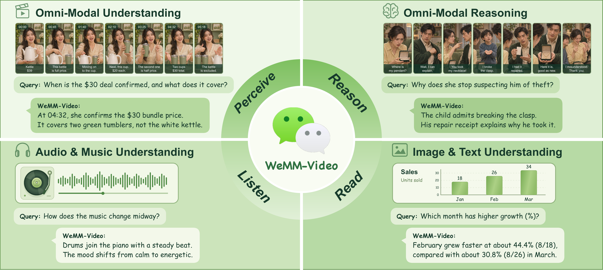
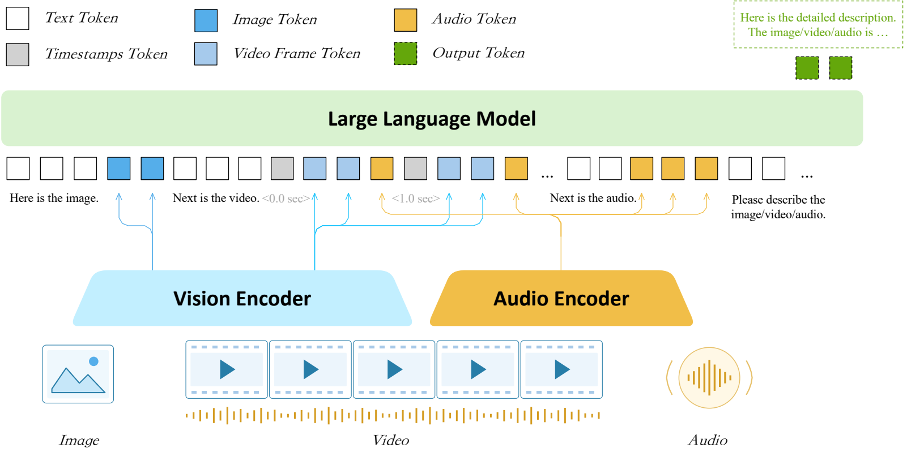
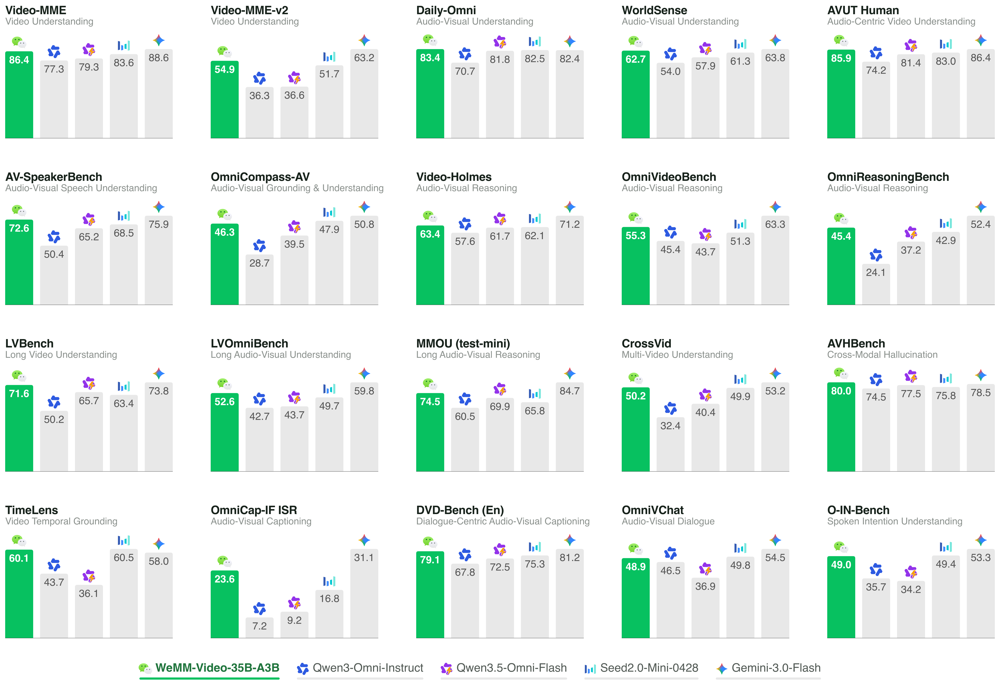
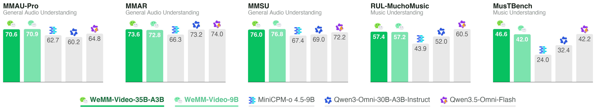

<h1 align="center">WeMM-Video: Pushing the Frontiers of Open-Source Omni-Modal Video Understanding</h1>

<p align="center">
  <a href="README.md">English</a> · <b>简体中文</b>
</p>

<p align="center">
  <a href="https://github.com/Tencent/WeMM-Video"></a>
  <a href="https://arxiv.org/abs/2611.26409"></a>
  <a href="https://huggingface.co/collections/tencent/wemm-video"></a>
  <a href="LICENSE#L12"></a>
</p>

<p align="center">
  <a href="#架构与评测">架构与评测</a> ·
  <a href="#模型列表">模型列表</a> ·
  <a href="#快速开始">快速开始</a> ·
  <a href="#部署与示例">部署与示例</a> ·
  <a href="#引用">引用</a>
</p>

## 模型概览

WeMM-Video 是面向音画联合感知与推理的中英双语全模态基础模型系列。模型接收文本、图像、音频和视频，输出文本回答。处理视频时，模型可以同时利用画面和原始音轨。该系列包含 2B、4B、9B 稠密模型和 35B-A3B 混合专家模型（MoE）。

- **推理模式：** Instruct 模式快速直接作答；Thinking 模式支持显式多步推理。
- **模型训练：** 基于约 1.2 万亿多模态 token，通过渐进式预训练与多阶段后训练构建。

<p align="center">
  <a href="assets/wemm-video-capabilities-compact.png">
    
  </a>
</p>

## 架构与评测

下图展示了 WeMM-Video 系列的模型架构。
<p align="center">
  <a href="assets/wemm-video-architecture.pdf">
    
  </a>
</p>

**WeMM-Video-35B-A3B** 在全模态视频理解上刷新了开源模型最佳水平（SOTA），超越了 Qwen3.5-Omni-Flash 和 Seed2.0-Mini-0428 等闭源模型，并缩小了与 Gemini-3.0-Flash 的差距。

<p align="center">
  <a href="assets/wemm-video-benchmarks.png">
    
  </a>
</p>

**WeMM-Video-35B-A3B** 和 **WeMM-Video-9B** 在通用音频理解上取得了领先性能。

<p align="center">
  <a href="assets/wemm_index_audio.png">
    
  </a>
</p>

## 模型列表

| 规模 | BF16 | FP8 Block128 | AWQ W4A16 | GGUF Q4_K_M | NVFP4 W4A16 |
| --- | --- | --- | --- | --- | --- |
| 2B | [WeMM-Video-2B](https://huggingface.co/tencent/WeMM-Video-2B) | [WeMM-Video-2B-FP8](https://huggingface.co/tencent/WeMM-Video-2B-FP8) | [WeMM-Video-2B-AWQ](https://huggingface.co/tencent/WeMM-Video-2B-AWQ) | [WeMM-Video-2B-GGUF](https://huggingface.co/tencent/WeMM-Video-2B-GGUF) | [WeMM-Video-2B-NVFP4](https://huggingface.co/tencent/WeMM-Video-2B-NVFP4) |
| 4B | [WeMM-Video-4B](https://huggingface.co/tencent/WeMM-Video-4B) | [WeMM-Video-4B-FP8](https://huggingface.co/tencent/WeMM-Video-4B-FP8) | [WeMM-Video-4B-AWQ](https://huggingface.co/tencent/WeMM-Video-4B-AWQ) | [WeMM-Video-4B-GGUF](https://huggingface.co/tencent/WeMM-Video-4B-GGUF) | [WeMM-Video-4B-NVFP4](https://huggingface.co/tencent/WeMM-Video-4B-NVFP4) |
| 9B | [WeMM-Video-9B](https://huggingface.co/tencent/WeMM-Video-9B) | [WeMM-Video-9B-FP8](https://huggingface.co/tencent/WeMM-Video-9B-FP8) | [WeMM-Video-9B-AWQ](https://huggingface.co/tencent/WeMM-Video-9B-AWQ) | [WeMM-Video-9B-GGUF](https://huggingface.co/tencent/WeMM-Video-9B-GGUF) | [WeMM-Video-9B-NVFP4](https://huggingface.co/tencent/WeMM-Video-9B-NVFP4) |
| 35B-A3B | [WeMM-Video-35BA3B](https://huggingface.co/tencent/WeMM-Video-35BA3B) | [WeMM-Video-35BA3B-FP8](https://huggingface.co/tencent/WeMM-Video-35BA3B-FP8) | [WeMM-Video-35BA3B-AWQ](https://huggingface.co/tencent/WeMM-Video-35BA3B-AWQ) | [WeMM-Video-35BA3B-GGUF](https://huggingface.co/tencent/WeMM-Video-35BA3B-GGUF) | [WeMM-Video-35BA3B-NVFP4](https://huggingface.co/tencent/WeMM-Video-35BA3B-NVFP4) |

## 快速开始

### 安装依赖

请使用 Python 3.12、NVIDIA GPU、兼容 CUDA 12.9 的驱动和 FFmpeg。TorchCodec 的动态库依赖见[主机环境要求](patch/README.md#install)。以下命令在仓库根目录执行。

```bash
python3.12 -m venv .venv
source .venv/bin/activate
python -m pip install --index-url https://download.pytorch.org/whl/cu129 \
  torch==2.10.0 torchvision==0.25.0 torchcodec==0.10.0
python -m pip install transformers==5.2.0 accelerate pillow librosa soundfile scipy requests
```

### 使用 Transformers 从 Hugging Face 加载

在仓库根目录运行以下 Python 示例。示例从 Hugging Face 下载 2B BF16 权重和处理器，加载一次后完成五种输入的推理。启用 `trust_remote_code` 前请先审阅模型仓库中的自定义代码。将 `revision` 设为提交 SHA 可以固定权重和自定义代码的版本。

```python
import torch
from transformers import AutoModelForImageTextToText, AutoProcessor

model_id = "tencent/WeMM-Video-2B"
revision = "main"
processor = AutoProcessor.from_pretrained(
    model_id, revision=revision, trust_remote_code=True
)
model = AutoModelForImageTextToText.from_pretrained(
    model_id, revision=revision, trust_remote_code=True,
    dtype=torch.bfloat16, device_map="auto",
)


def ask(prompt, *media):
    messages = [{
        "role": "user",
        "content": [*media, {"type": "text", "text": prompt}],
    }]
    inputs = processor.apply_chat_template(
        messages, tokenize=True, return_dict=True, return_tensors="pt",
        add_generation_prompt=True, enable_thinking=False,
    ).to(device=model.device, dtype=model.dtype)
    with torch.inference_mode():
        output = model.generate(**inputs, max_new_tokens=128, do_sample=False)
    answer_ids = output[0, inputs.input_ids.shape[1]:]
    return processor.tokenizer.decode(answer_ids, skip_special_tokens=True)


# 文本。预期答案为 10:05。
print(ask("A meeting starts at 09:30 and lasts 35 minutes. What time does it end?"))

# 使用阿波罗 11 号档案中的图像和音频。
print(ask("Which planet is shown? Describe what you see.", {
    "type": "image", "image": "examples/media/apollo-11-earth.jpg",
}))
print(ask("Transcribe the English speech in this recording.", {
    "type": "audio", "audio": "examples/media/apollo-11-small-step.wav",
}))

# 使用同一个 MP4，分别测试纯画面和画面与原始音轨的联合输入。
clip = {
    "video": "examples/media/apollo-11-first-steps.mp4",
}
print(ask("Describe what happens on screen.", {"type": "video", **clip}))
print(ask("Describe the scene and summarize the speech.", {"type": "video_audio", **clip}))
```

示例默认使用 Instruct 模式。在 `apply_chat_template` 中设置 `enable_thinking=True` 即可启用 Thinking 模式。

如果只想在命令行运行带音轨的视频示例，可执行 `python examples/transformers_video.py`。脚本支持 `--video`、`--model` 和 `--revision`，以及可选的 `--fps`、`--max-frames` 和 `--total-pixels` 覆盖参数。

### 视频采样与资源占用

视频示例默认继承检查点 [`processor_config.json`](https://huggingface.co/tencent/WeMM-Video-2B/blob/main/processor_config.json) 的 `wemm_defaults`：`fps=2.0`、`min_frames=4`、`max_frames=128`、`total_pixels=25165824`、`min_pixels=4096`。服务客户端默认继承服务端配置，只有显式传参时才覆盖采样值。GGUF 启动器和原生运行时也使用这组视频默认值。128 帧是上限，实际帧数还取决于视频时长和采样帧率。

如果显存或算力不足，可以同时调低像素预算、最大帧数和采样帧率。例如，下例仅用于**低资源快速验证**：

```bash
python examples/transformers_video.py --video examples/media/apollo-11-first-steps.mp4 \
  --fps 1 --max-frames 16 --total-pixels 262144
```

`examples/chat.py video-audio` 和 `native/run_hf.py` 也支持这三个参数。调小参数会降低空间细节与时间覆盖，可能遗漏短暂动作或快切镜头。只增加帧数会让更多帧共享原有像素预算；单帧预算计算还包含处理器的 `×2` 时间维系数。服务端统一覆盖配置和上下文长度设置见[部署指南](docs/serving.md#video-sampling-and-memory)。

## 部署与示例

### 选择运行时

| 运行时 | 权重格式 | 使用指南 |
| --- | --- | --- |
| Transformers | BF16 | [从 Hugging Face 加载模型](#使用-transformers-从-hugging-face-加载) |
| 应用 patch 的 vLLM | BF16、FP8 Block128、AWQ W4A16、NVFP4 W4A16 | [版本与 GPU 要求](docs/serving.md#runtime-profiles) |
| 应用 patch 的 SGLang | BF16 | [部署命令](docs/serving.md) |
| 原生运行时 | GGUF Q4_K_M | [在 CPU 或 CUDA 上运行](native/README.md) |

如果直接在本机部署 vLLM 或 SGLang，请参照[手动安装与应用 patch 指南](patch/README.md#manual-install-and-patch)。

### Docker

镜像提供推理环境，默认进入 Bash。配置好 [Docker 和 NVIDIA Container Toolkit](docs/serving.md#docker-environments) 后，选择下方一种后端启动。两套示例都使用本地 `8000` 端口。访问受限模型时，请在宿主机的 shell 中导出 `HF_TOKEN`。

在配置的上下文长度内，每条请求最多可包含 4 张图片、2 段视频和 2 段音频。

#### vLLM

```bash
docker compose build vllm-018

MODEL=tencent/WeMM-Video-2B
docker run --rm --gpus all --shm-size=8g \
  --publish 127.0.0.1:8000:8000 \
  --mount type=volume,source=wemm-video-hub,target=/root/.cache/huggingface \
  --env HF_TOKEN \
  wemm-video:vllm-0.18.0-cu129 \
  vllm serve "$MODEL" --served-model-name "$MODEL" --trust-remote-code --dtype bfloat16 \
  --host 0.0.0.0 --port 8000 --max-model-len 65536 \
  --no-enable-prefix-caching --mamba-ssm-cache-dtype float32 \
  --limit-mm-per-prompt '{"image":4,"video":2,"audio":2}'
```

#### SGLang

```bash
docker compose build sglang-0516

MODEL=tencent/WeMM-Video-2B
docker run --rm --gpus all --shm-size=8g \
  --publish 127.0.0.1:8000:8000 \
  --mount type=volume,source=wemm-video-hub,target=/root/.cache/huggingface \
  --env HF_TOKEN \
  wemm-video:sglang-0.5.16-cu129 \
  python -m sglang.launch_server --model-path "$MODEL" --served-model-name "$MODEL" --trust-remote-code \
  --host 0.0.0.0 --port 8000 --dtype bfloat16 --context-length 65536 \
  --attention-backend triton --linear-attn-backend triton \
  --limit-mm-data-per-request '{"image":4,"video":2,"audio":2}'
```

#### 发送请求

对于上述两种应用 patch 的后端，向 `POST /v1/chat/completions` 发送 `video_url` 内容项即可。将 `video_url.use_audio` 设为 `true` 可包含原始音轨，设为 `false` 则仅处理画面帧。不填采样字段时继承服务端默认值；在 `video_url` 内设置 `fps`、`max_frames` 和 `total_pixels` 可按视频覆盖。Thinking 模式的配置方法见[完整 HTTP 请求示例](docs/serving.md#send-a-video-request)。

命名卷会缓存已下载的权重，供后续容器复用。服务就绪后，在另一个终端进入仓库根目录，用仓库附带的视频发起请求。

```bash
curl --fail --silent --show-error http://127.0.0.1:8000/health
python examples/chat.py video-audio --model tencent/WeMM-Video-2B
```

[示例](examples/README.md)覆盖文本、图像、音频、视频及带音轨的视频。

## 许可证

WeMM-Video 项目源码按 [Apache License 2.0](LICENSE#L12) 授权。[模型许可证](LICENSE)适用于截至 2026 年 11 月 20 日的 WeMM-Video 模型集合。适用的第三方条款和归属信息见[第三方声明](THIRD_PARTY_NOTICES.md)和[示例媒体署名](examples/README.md#media-credits)。各检查点的许可详情见对应的 Hugging Face 模型卡。

## 引用

如果你在研究中使用了 WeMM-Video，请引用本项目。

```bibtex
@misc{WeMM-Video,
      title={WeMM-Video: Pushing the Frontiers of Open-Source Omni-Modal Video Understanding}, 
      author={Changli Tang and Jie Yang and Tianyi Wang and Lei Li and Daoze Zhang and Zijie Xin and Zhan Liu and Li Li and Jinchang Xu and Fengyun Rao and Chao Zhang and Jing Lyu},
      year={2026},
      eprint={2611.26409},
      archivePrefix={arXiv},
      primaryClass={cs.CV},
      url={https://arxiv.org/abs/2611.26409}, 
}
```
